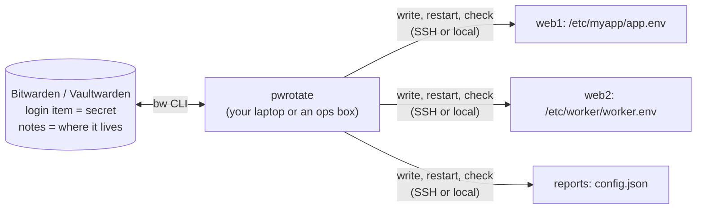

# pw-manager-auto-rotate

**Your password manager already holds every secret. Now it can rotate them on every server too.**

[](https://github.com/thejocorp/pw-manager-auto-rotate/actions/workflows/ci.yml)


[](LICENSE)



An API key or database password usually lives in more places than anyone remembers: a `.env`
here, a JSON config there, a second server someone set up last year. `pwrotate` keeps the real
value in **Bitwarden** (or your own **Vaultwarden**) and pushes it to every place you list. A
rotation writes the new value everywhere, restarts what needs it and runs your health checks.
**If a check fails, every copy goes back to the old value.**

- **Your vault is the source of truth.** Each secret is a normal Bitwarden login item. Every
  change lands in the item's password history, so you can undo it from any Bitwarden app.
- **Your vault becomes the map.** The item's notes list every file and server that uses the
  secret, kept up to date on each rotation. Your own notes stay as they are.
- **Nothing new to run.** No server, no agent and no database: a small Python tool, the official
  `bw` CLI and SSH. Values are never printed; copies are compared by fingerprint.

## Quick start

```sh
# 1. the Bitwarden CLI, logged in (skip `config server` for bitwarden.com)
npm install -g @bitwarden/cli
bw config server https://vault.example.com
bw login
export BW_SESSION=$(bw unlock --raw)

# 2. pwrotate itself (Python 3.9+, no dependencies)
pipx install git+https://github.com/thejocorp/pw-manager-auto-rotate

# 3. say where your secrets live, then look before you leap
cp examples/secrets.example.yaml secrets.yaml      # edit it
pwrotate --manifest secrets.yaml doctor            # bw found? unlocked? every secret in the vault?
pwrotate --manifest secrets.yaml status            # does every copy match the vault?
pwrotate --manifest secrets.yaml rotate myapp/api-key --dry-run
pwrotate --manifest secrets.yaml rotate myapp/api-key
```

YAML manifests need the extra: `pipx install "pw-manager-auto-rotate[yaml] @ git+https://github.com/thejocorp/pw-manager-auto-rotate"`.
JSON works without it.

## How it fits together



1. A **manifest** lists your secrets and, for each, the **places** a copy lives: a host, a file,
   a format and the key inside that file. It holds no values, only locations, so it can live in git.
2. **Bitwarden** holds the values: one login item per secret, its name being the secret's name.
3. `rotate` makes a new value (or takes one from stdin), saves it in Bitwarden, writes every
   place (backing each file up first), runs your restarts and checks, and **rolls everything
   back** if a check fails.

## Bitwarden setup

**Personal vault or organization.** With no settings, items are looked up in (and created in)
your own vault. For a team, put them in an organization collection so everyone with access sees
the same secrets and the same history:

```yaml
bitwarden:
  organization: Homelab      # name or id
  collection: Servers        # name or id; new items are created here
secrets:
  - name: myapp/api-key
    ...
```

**New secrets** need no preparation: the first `rotate` of a name that is not in the vault yet
creates the login item, with its notes filled in.

**Self-hosted.** Vaultwarden speaks the same API, so `bw config server https://your-vault` is
all it takes. New to that? The companion guide
[self-hosted-password-manager](https://github.com/thejocorp/self-hosted-password-manager) sets up
Vaultwarden with HTTPS, backups and the Bitwarden apps in an evening.

**Unattended runs** (a cron job, CI): give pwrotate its own Bitwarden account that can only see
the one collection it rotates, log it in with an
[API key](https://bitwarden.com/help/personal-api-key/) and unlock with a password from the
environment:

```sh
export BW_CLIENTID=... BW_CLIENTSECRET=...      # the ops account's API key
bw login --apikey
export BW_SESSION=$(bw unlock --passwordenv BW_PASSWORD --raw)
pwrotate --manifest /etc/pwrotate/secrets.yaml status || alert "secrets drifted"
```

Anyone who can read that machine's environment can read that collection, so keep the account's
access narrow and the machine locked down.

`pwrotate doctor` checks the whole chain (CLI installed, server, account, locked or unlocked,
every secret present) and says what to do about the first thing that is wrong.

## The manifest

JSON ([`examples/secrets.example.json`](examples/secrets.example.json)) or YAML
([`examples/secrets.example.yaml`](examples/secrets.example.yaml)):

```yaml
secrets:
  - name: myapp/api-key          # the Bitwarden item name
    kind: generated              # generated = random value; provider = you paste one in
    bytes: 32
    places:
      - { host: local, file: /etc/myapp/app.env, format: env, key: API_KEY, mode: "600" }
      - { host: "ssh:deploy@web2.example", file: /etc/myapp/app.env, format: env, key: API_KEY }
    restart:
      - { host: local, cmd: systemctl restart myapp }
    check:
      - { host: local, cmd: "curl -fsS http://127.0.0.1:8080/health" }
```

**Formats** (how the value sits in a file):

| format | the value is | `key` is |
|---|---|---|
| `env` | `KEY=value` in a dotenv/shell file (quotes and `export` kept) | the variable name |
| `line` | the rest of a `prefix value` line | the literal prefix incl. separator, e.g. `"secret: "` |
| `json` | a string at a (possibly dotted) path | e.g. `database.password` |
| `ini` | `key = value` under a section | `section.key` |
| `raw` | the whole file | (unused) |

**Hosts**: `local` for this machine, `ssh:user@host` over SSH (key-based SSH must already work;
the remote side needs a Linux userland, for `chmod`/`chown --reference`).
**Checks** run after a rotation; a non-zero exit triggers the rollback. Add `stdin: true` to a
step to hand it the new value on standard input, for a check that must log in with it.

## Commands

```sh
pwrotate doctor                 # Bitwarden reachable and unlocked? every secret in the vault?
pwrotate status [NAME]          # does every copy match the vault? (fingerprints only)
pwrotate push NAME              # write the vault value to every place, restart, check
pwrotate rotate NAME            # new value -> Bitwarden -> every place -> restart -> check -> (rollback)
pwrotate rotate NAME --stdin    # the new value from stdin (a key your provider issued)
pwrotate rotate NAME --dry-run  # show what would change
```

`--manifest FILE` or `$PWROTATE_MANIFEST` picks the manifest; `--no-sync` skips `bw sync`.
Exit codes: `0` all good, `1` a copy disagrees, a secret is missing or a rotation rolled back,
`2` a usage or vault error. That makes `pwrotate status` a drift alarm in any scheduler.

## Safety

- **Values are never printed or logged.** You see 12-character SHA-256 fingerprints, enough to
  spot a stale copy without exposing the secret.
- **Every file is backed up** (`file.bak-<timestamp>`) before it is overwritten, unless you pass
  `--no-backup`. Backups and new files are private (600).
- **Mode and owner are kept.** A config the service reads as its own user (say `640 root:app`)
  stays exactly that after a rotation. If pwrotate cannot keep the owner, it refuses to write.
- **A failed check rolls back** the vault and every place to the previous value.
- **Bitwarden keeps the history.** Even after a successful rotation the old value is one click
  away in the item's password history.

## Why not a secrets server?

HashiCorp Vault, Infisical, Doppler or Bitwarden Secrets Manager inject secrets into running
services, which is the right tool when you run many services and can change how each one reads
its config. Most homelabs and small fleets cannot: the secret has to stay in the `.env` or the
config file the software expects. pwrotate is for that case. It keeps those files in step with
the password manager you already use, and it adds no server.

## Extending

- Another **vault**: subclass `Vault` (`get`, `set`).
- Another **transport** (a container runner, a config-management agent): subclass `Transport`
  (`read`, `write`, `run`).

## Part of a small self-hosted security kit

| | |
|---|---|
| [self-hosted-password-manager](https://github.com/thejocorp/self-hosted-password-manager) | run your own Vaultwarden with the Bitwarden apps, safely |
| **pw-manager-auto-rotate** | rotate the secrets it holds on every server |
| [plugin-vet](https://github.com/thejocorp/plugin-vet) | check AI-agent plugins and MCP servers before they get near those secrets |

## License

MIT. See [LICENSE](LICENSE). Not affiliated with Bitwarden, Inc.; Bitwarden is their trademark.
